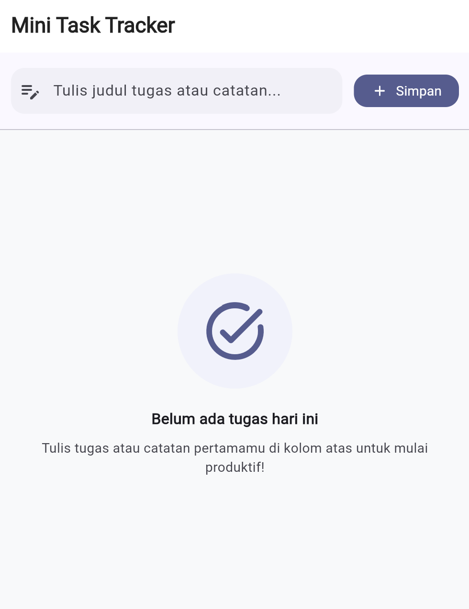
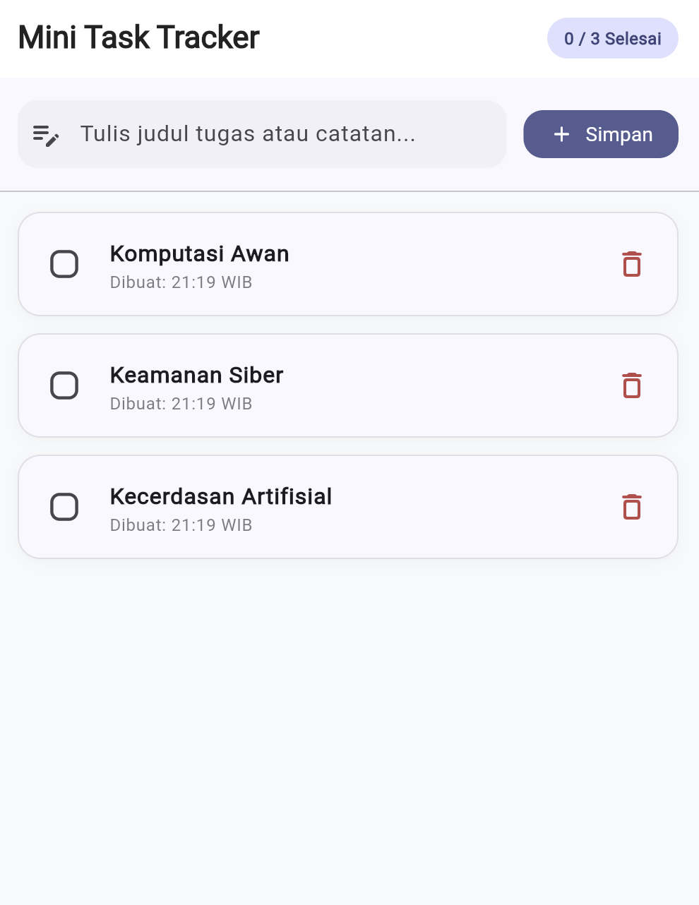

# Mini Task Tracker / Catatan Harian Sederhana

Aplikasi mobile berbasis Flutter untuk mencatat daftar tugas dan catatan harian secara praktis dan responsif. Dibuat untuk pemenuhan tugas seleksi Mobile Developer Study Group / Laboratorium Motion.

---

## Identitas Peserta
- **Nama:** Adam Nugraha
- **NIM:** 103012400280
- **Platform:** Flutter (Dart)

---

## Fitur Utama
1. **Input Data**:
   - Kolom teks (`TextField`) untuk memasukkan judul catatan/tugas baru.
   - Tombol **Simpan** untuk menambahkan tugas ke dalam daftar.
   - Validasi input (mencegah penyimpanan teks kosong).
2. **Tampilan Daftar (List)**:
   - Menampilkan catatan yang sudah ditambahkan menggunakan `ListView.builder`.
   - Menampilkan waktu pembuatan catatan.
   - Tampilan *Empty State* saat belum ada catatan yang dibuat.
   - Indikator progres jumlah tugas yang selesai di AppBar.
3. **Aksi Sederhana**:
   - **Tandai Selesai**: Checkbox untuk menandai tugas telah selesai dengan efek coret (*strikethrough*).
   - **Hapus Catatan**: Tombol hapus disertai dialog konfirmasi (*AlertDialog*) dan tombol *Undo* pada SnackBar.
4. **State Management**:
   - Menggunakan state lokal bawaan Flutter (`StatefulWidget` & `setState()`) dengan penyimpanan data di memori aplikasi.

---

## Demo Aplikasi

| Empty State | Daftar Catatan | Aksi Centang & Hapus |
| :---: | :---: | :---: |
|  |  |  |

---

## Cara Menjalankan Aplikasi

Pastikan Flutter SDK telah terpasang di komputer Anda.

1. **Clone Repositori:**
   ```bash
   git clone https://github.com/Adam-Nugraha225/Mobile-Dev-Mini_Task.git
   cd Mobile-Dev-Mini_Task
   ```

2. **Unduh Dependensi:**
   ```bash
   flutter pub get
   ```

3. **Jalankan Aplikasi:**
   Hubungkan perangkat Android atau emulator, lalu jalankan:
   ```bash
   flutter run
   ```

4. **Build APK:**
   ```bash
   flutter build apk --debug
   ```
   File hasil build berada di:
   `build/app/outputs/flutter-apk/app-debug.apk`

---

## Struktur Folder

```text
lib/
├── models/
│   └── task_model.dart       # Model data Task
├── widgets/
│   ├── empty_state.dart      # Tampilan saat daftar kosong
│   └── task_tile.dart        # Item kartu tugas (Checkbox, judul, hapus)
├── screens/
│   └── home_screen.dart      # Halaman utama dan logika setState
└── main.dart                 # Entry point dan tema aplikasi
```

---

### Deklarasi Penggunaan AI

- Apakah menggunakan AI? Ya
- Tool AI yang digunakan: ChatGPT-4o
- Estimasi persentase kontribusi AI: 30%
- Bagian kode/fitur yang dibantu AI:
  Referensi styling Material 3 dan syntax validasi input form
- Pernyataan:
  "Saya menyatakan bahwa saya memahami alur dan fungsi dari seluruh kode yang ada dalam repositori ini"
